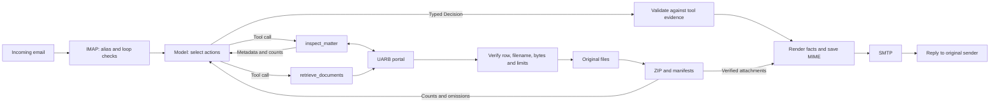
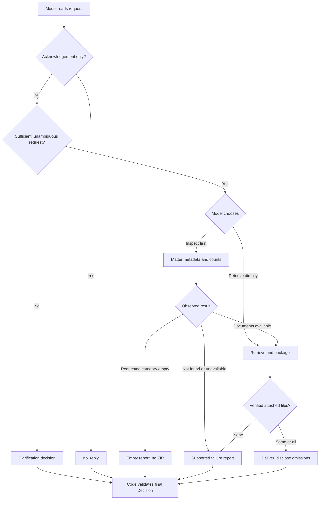
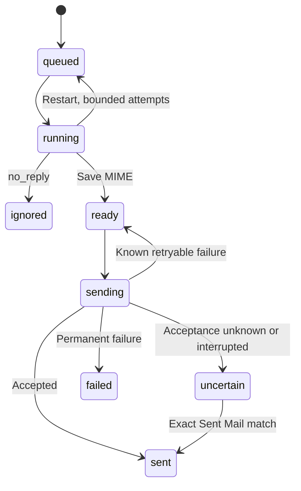
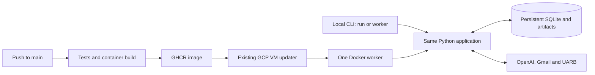

# Architecture

One Python process handles one request at a time. `agent.py` gives GPT-6 Luna two tools and a typed `Decision`; the OpenAI Agents SDK runs the loop. The model selects actions. Python controls their allowed inputs, source verification and delivery.

## Request and evidence flow

`mail.py` fetches bodies only after matching the exact alias in To. The alias must differ from the primary address; self-mail and automatic replies are ignored. Polling defaults to 30 seconds. Jobs are saved before the inbox cursor advances.

Model inputs and tool observations are capped at 8,000 UTF-8 bytes. The model receives cleaned text and any verified thread matter, without credentials or paths. Matter, category and limit checks bind execution to the request; arbitrary URLs and recipients are rejected.

## Model decisions

Inspection is optional. Retrieval returns its observations before the model decides to finish. Repeated completed retrieval calls reuse artifacts within the same run. Model and portal operations share one eligible transient retry; quota failures do not retry. Runs stop after six model turns or eight minutes. The portal separately confirms a negative lookup with two searches.

## Files, state and delivery

Playwright navigates; HTTPX streams within source, time and disk bounds. Active-row and filename checks protect source identity. Non-public files are skipped; successful sibling files survive later failures. Packaging verifies original and archived hashes. Replies use those facts.

SQLite stores jobs, cursor and reply status; files hold artifacts and exact outgoing MIME. No full MIME reparse is needed to send the saved message.

Uncertain sends are checked, never blindly replayed. Authentication failure holds the prepared reply for five minutes. Model preparation allows two attempts across restarts; exhaustion produces a failure reply.

## Execution and deployment

The worker runs on the existing GCP VM. The updater preserves `/data` and requires a fresh heartbeat and inbox poll before accepting a replacement. Rollback uses the current shared ledger and cursor, never a stale backup. Local `docket run` uses the same agent without sending email.

Action logs record selected tools, counts and outcomes without email bodies or hidden reasoning. Each request has a trace ID linking its local events to the OpenAI Agents SDK trace viewer. SDK traces show model and tool spans with inputs and outputs excluded; export runs in the background. Use `docket status` for saved delivery state; after deployment, `docker logs --follow --since 1m docket` shows live worker output. A model's completion is separate from email delivery.
